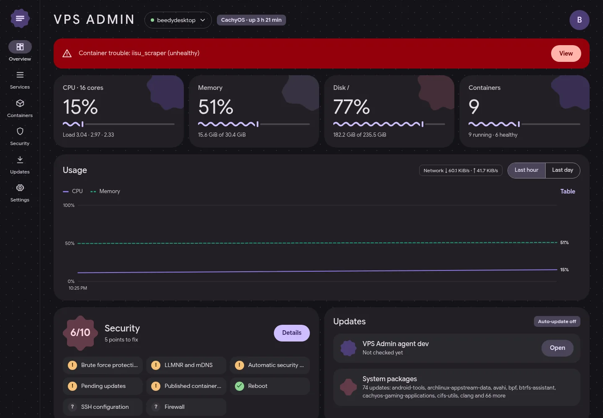
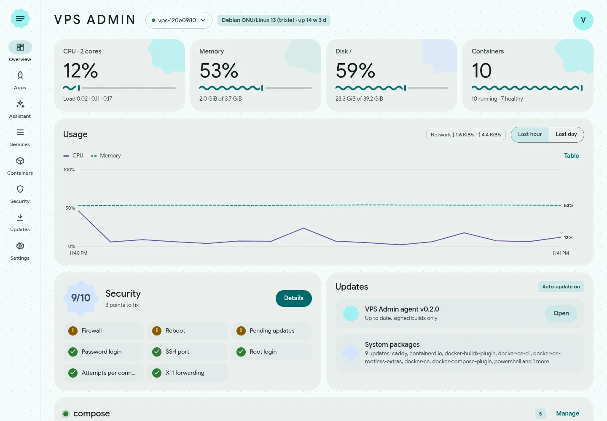
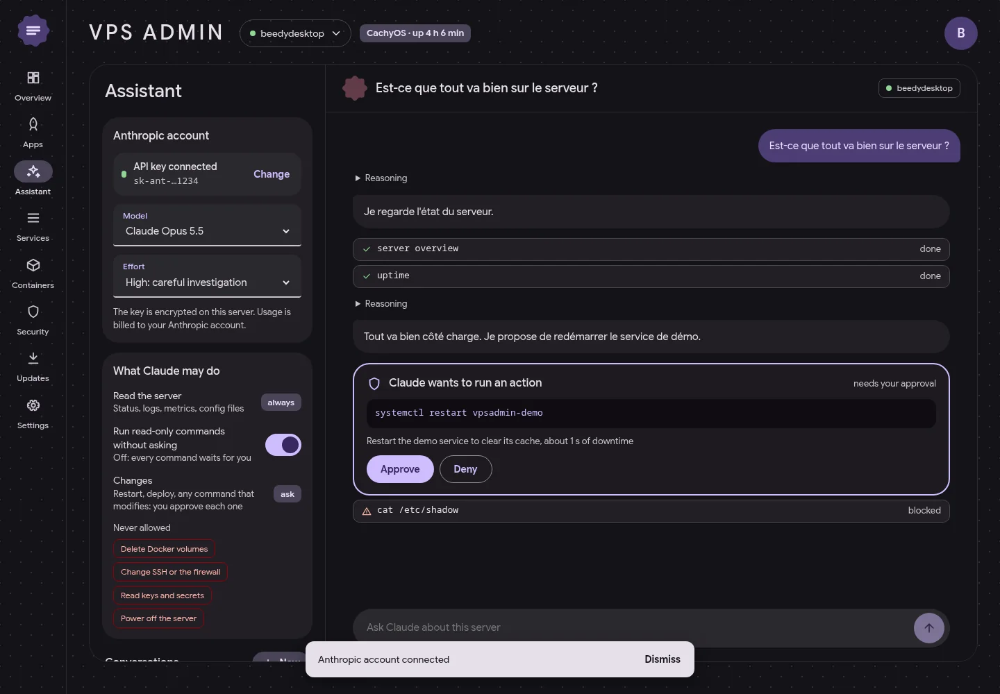
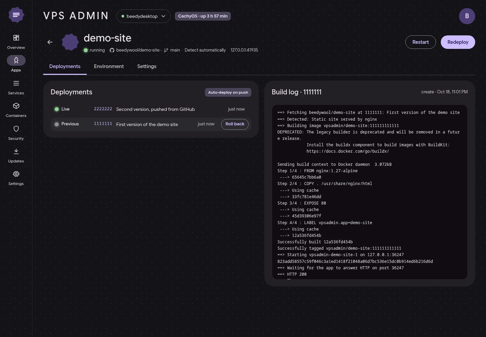
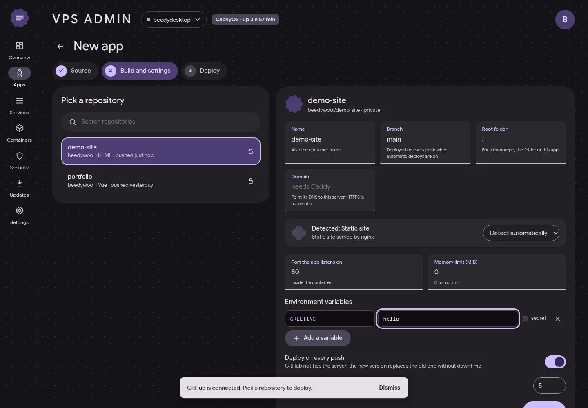
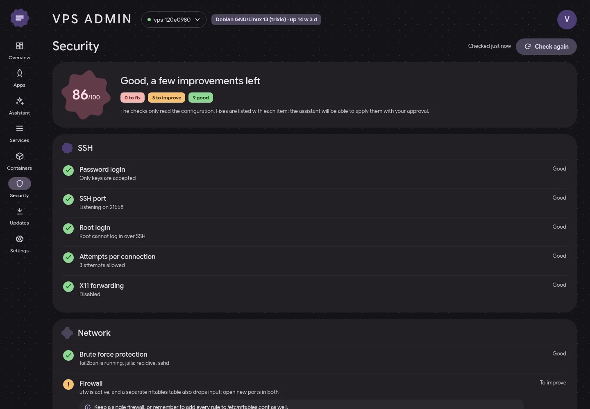
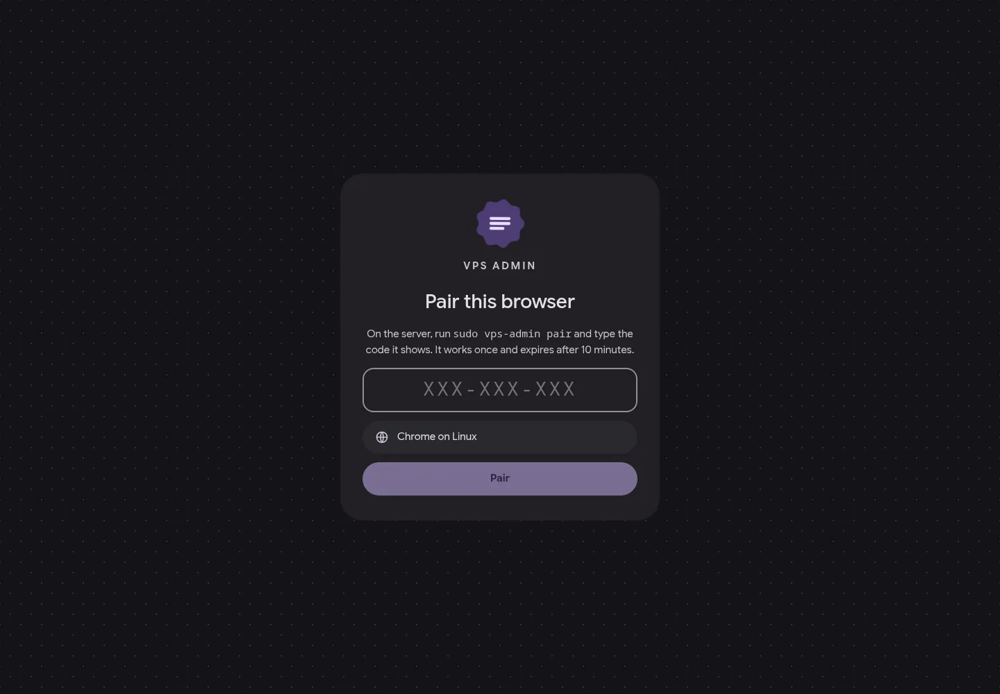
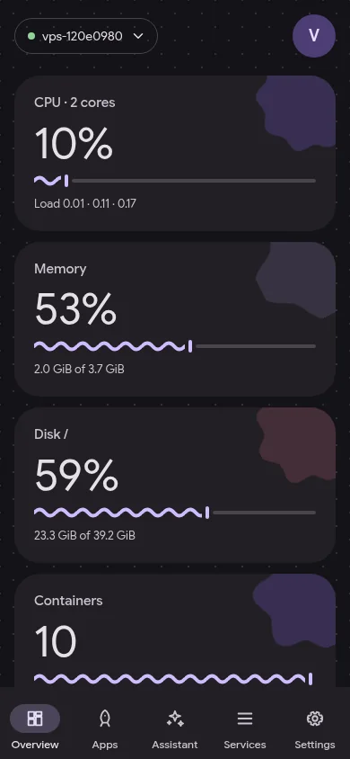

<div align="center">


<br>
<br>

<a href="https://go.dev"></a>
<a href="https://vuejs.org"></a>
<a href="https://flutter.dev"></a>
<a href="https://m3.material.io"></a>
<a href="https://www.sqlite.org"></a>
<a href="https://www.docker.com"></a>
<a href="https://caddyserver.com"></a>


<br>
<br>

<b>
<a href="#preview">Aperçu</a> ·
<a href="#features">Fonctionnalités</a> ·
<a href="#install">Installation</a> ·
<a href="#security">Sécurité</a> ·
<a href="#stack">Stack</a> ·
<a href="#dev">Développement</a>
</b>

</div>

<br>

> **VPS Admin** est un panel d'administration à installer sur n'importe quel VPS Linux.
> Il tient en **un seul binaire Go** qui embarque le panel web Material 3, et une **app Android** en Material You
> gère plusieurs serveurs. On y suit le serveur en direct, on déploie ses repos GitHub dans Docker en un clic,
> et un assistant IA, local ou en ligne, enquête sur les pannes. **Chaque modification attend ton approbation.**

<br>

<a name="preview"></a>


<table>
<tr>
<th>Vue d'ensemble</th>
<th>Material You, couleur Teal en thème clair</th>
</tr>
<tr>
<td></td>
<td></td>
</tr>
<tr>
<th>Assistant : une action attend l'approbation</th>
<th>App déployée depuis GitHub</th>
</tr>
<tr>
<td></td>
<td></td>
</tr>
<tr>
<th>Nouvelle app : type de build détecté</th>
<th>Audit de sécurité</th>
</tr>
<tr>
<td></td>
<td></td>
</tr>
</table>

<div align="center">


<br>
<sub>Appairage par code, puis passkey · Le panel sur téléphone</sub>
</div>

<br>

<a name="features"></a>


<table>
<tr>
<td width="33%" valign="top">

### Le serveur en direct
CPU, mémoire, disques, réseau et charge toutes les 5 secondes, historique sur **1 h et 24 h**.
Services systemd et conteneurs Docker groupés par projet compose : démarrer, arrêter,
redémarrer, **logs en direct**. Arrêter SSH ou le panel lui-même est refusé.

</td>
<td width="33%" valign="top">

### Déploiements GitHub
Une **GitHub App** se crée en un clic, en lecture seule sur les repos choisis. Dockerfile,
Compose, Node ou site statique : le type est **détecté tout seul**, commandes d'install,
de build et de démarrage personnalisables. Chaque push redéploie **sans coupure**, avec un
retour arrière instantané et un domaine HTTPS via Caddy. Un dossier compose déjà en place
se lie aussi à son repo : même mise à jour au push, bouton **Vérifier** et **Mettre à jour**,
et ses scripts s'affichent à côté de ses conteneurs.

</td>
<td width="33%" valign="top">

### Assistant IA
Trois fournisseurs au choix, réglables dans le panel : **Ollama** en local (gratuit, rien
ne sort du serveur), **Gemini** avec la clé gratuite d'AI Studio, ou **Claude Code** avec
ton abonnement Pro/Max (le CLI installé sur le serveur, ses outils natifs coupés ; aucune
clé API payante). L'assistant examine la machine avec les outils du panel et propose des
corrections. Les lectures passent seules, **chaque modification attend ton accord**, et
certaines actions sont bloquées quoi qu'il arrive.

</td>
</tr>
<tr>
<td valign="top">

### Audit de sécurité
Port SSH, mots de passe, root, pare-feu, **ufw et nftables qui se superposent**,
fail2ban, mises à jour en attente, LLMNR, ports ouverts et ports Docker qui
**contournent ufw**. Chaque point vient avec sa correction.

</td>
<td valign="top">

### Plusieurs serveurs
L'app Android passe d'un serveur à l'autre depuis la barre du haut. Sur le web, chaque
panel est celui du serveur qui l'héberge, avec sa propre passkey liée à son domaine.

</td>
<td valign="top">

### Mises à jour automatiques
Un tag sur GitHub suffit : les binaires sont **signés en ed25519** et l'APK est compilé.
Les agents installent la nouvelle version tout seuls, et reviennent à l'ancienne
si elle ne démarre pas. L'app se met à jour via le serveur.

</td>
</tr>
</table>

<br>

<a name="install"></a>


Sur le serveur, en root, avec un nom de domaine qui pointe dessus :

```sh
curl -fsSL https://github.com/beedywool/vps-admin/releases/latest/download/install.sh \
  | sudo bash -s -- --domain admin.example.com
```

Repo **privé** : ajoute `--token <jeton>`, un jeton GitHub *fine-grained* en lecture seule sur « Contents » de ce repo. Il reste dans la config pour que les mises à jour continuent.

| Étape | Ce que fait l'installeur |
| --- | --- |
| 1 | Télécharge le binaire (amd64 ou arm64), vérifie la **signature ed25519** puis le checksum |
| 2 | Crée l'utilisateur système `vps-admin` (groupes `docker`, `systemd-journal`, `adm`) |
| 3 | Écrit la liste blanche sudo avec les vrais chemins des commandes |
| 4 | Installe le service systemd et le script de retour arrière |
| 5 | Configure le reverse proxy trouvé : Caddy (domaine et dossier des apps) ou nginx (site dédié et certificat Let's Encrypt via certbot, proposé à l'installation s'il manque) |
| 6 | Affiche un **code d'appairage** |

**Panel privé.** Si Tailscale tourne, l'installeur propose de servir le panel **uniquement sur le tailnet** (`--tailscale`, ou `--public` pour ne pas être questionné) : `tailscale serve` le publie sur `https://machine.tailnet.ts.net` avec un certificat du tailnet (active « HTTPS » dans la console Tailscale), et le domaine public ne reçoit plus que les webhooks GitHub. Pour WireGuard ou une IP de bureau : `--allow 10.8.0.0/24,…`, le reste reçoit un 403 (webhooks et renouvellement des certificats restent ouverts). Autres options : `--proxy caddy|nginx|none`, `--email`, `--no-tls`.

Ouvre ensuite le domaine, tape le code, crée ta passkey. Pour l'app ou un autre navigateur : `sudo vps-admin pair`. Relancer l'installeur répare ou met à jour sans toucher aux données.

<br>

<a name="security"></a>


<table>
<tr>
<td width="50%" valign="top">

**Accès**
- **Code d'appairage** généré par root : à usage unique, 10 minutes, seul le dernier compte, essais limités.
- **Web** : passkey obligatoire, cookie `__Host-` `SameSite=Strict`, en-tête anti-CSRF.
- **App** : jeton par appareil, gardé dans le stockage chiffré d'Android, révocable.
- **Journal d'audit** de chaque connexion et de chaque action, avec l'appareil et l'IP.

</td>
<td width="50%" valign="top">

**Serveur**
- L'agent écoute sur `127.0.0.1`, le TLS est assuré par Caddy ou par nginx avec certbot.
- Utilisateur dédié, root seulement pour les commandes de `/etc/sudoers.d/vps-admin`.
- Variables d'environnement, clé GitHub App et clés des fournisseurs d'IA **chiffrées** (AES-GCM).
- L'assistant ne peut jamais supprimer de volumes, toucher à SSH ou au pare-feu, lire des clés, ni éteindre le serveur.

</td>
</tr>
</table>

> L'accès Docker reste équivalent à root, comme pour tout outil d'administration Docker.

<br>

<a name="stack"></a>


<table>
<tr>
<th align="left">Dossier</th>
<th align="left">Contenu</th>
</tr>
<tr><td><code>cmd/vps-admin</code></td><td>Point d'entrée : <code>serve</code>, <code>pair</code>, <code>version</code>.</td></tr>
<tr><td><code>internal/api</code></td><td>Routes HTTP, flux SSE, en-têtes de sécurité, panel embarqué.</td></tr>
<tr><td><code>internal/auth</code></td><td>Appairage, jetons, sessions, passkeys (go-webauthn).</td></tr>
<tr><td><code>internal/system</code></td><td>Métriques lues dans <code>/proc</code>, services systemd, audit de sécurité.</td></tr>
<tr><td><code>internal/docker</code></td><td>Client minimal de l'API Docker par le socket.</td></tr>
<tr><td><code>internal/deploy</code></td><td>Build et lancement des apps, contrôle HTTP, bascule Caddy, retour arrière.</td></tr>
<tr><td><code>internal/github</code></td><td>GitHub App (manifest), jetons d'installation, webhooks signés.</td></tr>
<tr><td><code>internal/assistant</code></td><td>Boucle de conversation, adaptateur OpenAI-compatible (Gemini, Ollama), pont MCP pour le CLI Claude Code, outils, politique d'approbation.</td></tr>
<tr><td><code>internal/update</code></td><td>Releases signées, installation, distribution de l'APK.</td></tr>
<tr><td><code>internal/store</code></td><td>SQLite en pur Go (binaire statique), historique append-only.</td></tr>
<tr><td><code>web/</code></td><td>Panel Vue 3 + Vite, Material 3 Expressive, palette Material You générée depuis une couleur de base.</td></tr>
<tr><td><code>app/</code></td><td>Flutter 3.44, <code>dynamic_color</code>, plusieurs serveurs, mise à jour intégrée.</td></tr>
<tr><td><code>deploy/</code></td><td>Installeur, unité systemd, <code>preflight.sh</code> (retour arrière).</td></tr>
</table>

<br>

<a name="dev"></a>


```sh
cd web && npm ci && npm run build && cd ..      # le panel est compilé dans internal/web/dist
go test ./...
go run ./cmd/vps-admin serve -config dev.json   # 127.0.0.1:7171 par défaut
go run ./cmd/vps-admin pair -config dev.json
cd app && flutter test                          # l'app Android
```

<details>
<summary><b>Tests d'intégration</b></summary>

<br>

- `VPSADMIN_DOCKER_TEST=1 go test ./internal/deploy -run Docker` : déploiement réel sur le Docker local, bascule, version cassée refusée, retour arrière, suppression.
- L'installeur et le retour arrière se testent dans un conteneur Debian avec systemd (`deploy/install.sh --binary`).
- `VPS_ADMIN_GITHUB_API` et `VPS_ADMIN_ANTHROPIC_URL` pointent l'agent vers de faux serveurs pour les tests de bout en bout.
- `VPS_ADMIN_OLLAMA_TEST=1 go test ./internal/assistant -run OllamaLive` interroge un vrai Ollama local, avec `qwen3:1.7b` par défaut (`VPS_ADMIN_OLLAMA_MODEL` pour en changer).
- `VPS_ADMIN_CLAUDE_TEST=1 go test ./internal/assistant -run ClaudeCodeLive` lance le vrai binaire `claude` contre un faux serveur Anthropic : il vérifie la vérification du jeton à l'enregistrement (un jeton révoqué est refusé, un jeton valide est gardé), le pont MCP, l'exécution d'un outil de lecture, l'approbation et le refus d'une modification, sans abonnement.

</details>

<details>
<summary><b>Publier une version</b></summary>

<br>

Pousser un tag `vX.Y.Z` lance le workflow `release` :
1. il compile les binaires et l'APK ;
2. il signe `SHA256SUMS` avec le secret `RELEASE_SIGNING_KEY` ;
3. il publie la release.

Pour un fork, génère ta propre paire de clés :

```sh
go run ./tools/release-sign -keygen
```

Les visuels de ce README se régénèrent avec `python3 tools/readme-assets.py <dossier de captures>`.

</details>

<br>


